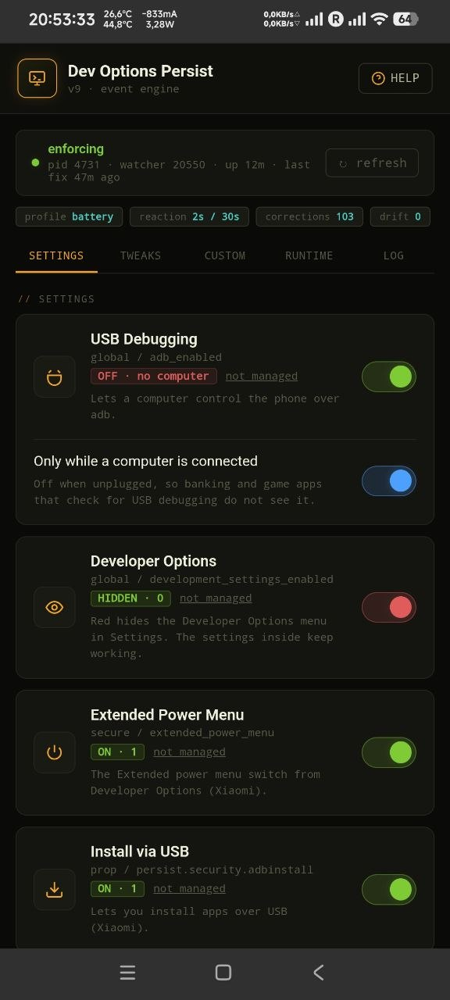

<p align="center"></p>

# Developer Options Persist

<p align="center">
  
  
  
  
</p>

A Magisk / KernelSU / APatch module that keeps USB debugging, Install via USB, the extended power menu and your mock location app in place **while Developer Options stay hidden** in Settings.

> **Tested on:** Poco F6 Pro · Xiaomi.eu ROM (HyperOS 3, Android 16) · SukiSU-Ultra.
> Other devices and ROMs are untested. The module relies on how Android stores settings, properties and AppOps, which manufacturers are free to change - see [Compatibility](#compatibility) before reporting that something does not work.

---

## What it does

Turning Developer Options off in Android's Settings also turns off everything inside it - USB debugging goes with it. This module keeps the switches you care about in the state you chose and puts Developer Options back out of sight, so the menu is hidden but ADB keeps working.

It enforces these values:

| Setting | Where it lives |
|---|---|
| USB Debugging | `global / adb_enabled` |
| Developer Options | `global / development_settings_enabled` |
| Extended Power Menu | `secure / extended_power_menu` |
| Install via USB | `persist.security.adbinstall` |
| USB Debugging (Security) | `persist.security.adbinput` |
| Mock Location App | AppOp `android:mock_location` |

On the **Tweaks** tab, all not managed until you pick a value:

| Setting | Where it lives | Values |
|---|---|---|
| Window / Transition / Animator Animation Scale | `global / window_animation_scale`, `transition_animation_scale`, `animator_duration_scale` | off, 0.5x, 1x, 1.5x, 2x, 5x, 10x |
| Stay Awake (screen on while charging) | `global / stay_on_while_plugged_in` | on (stored as 7) / off |
| Verify Apps over USB | `global / verifier_verify_adb_installs` | on / off |
| Phantom Process Killer | `persist.sys.fflag.override.settings_enable_monitor_phantom_procs` | on / off (Android 12L+) |

Turning the Phantom Process Killer off is the same as "Disable child process restrictions" in Developer Options: Android stops killing the child processes of apps like Termux.

Extended Power Menu and the two `persist.security.*` properties are Xiaomi / HyperOS specific. On other devices set them to `skip` in the config or leave them - they simply have no effect.

### Mock location app

Choosing a *mock location app* in Developer Options is not a setting but an AppOp: the chosen app gets `allow`, every other one `deny`. The module does the same, so you can pick the app from the WebUI while Developer Options stay hidden, and it is put back if anything changes it. The picker lists every installed app that asks for `ACCESS_MOCK_LOCATION`, whether or not it was ever selected, so a newly installed app appears on its own. Not managed by default.

---

## Features

- **Event-driven enforcement.** Changes are undone within a second or two, and an idle daemon starts no processes at all. See [Battery](#battery).
- **Profiles** - fast, balanced or battery; **engine** - events or timed checks. Both switchable from the WebUI, effective immediately.
- **Web UI** - per-setting toggles with the live value next to each, a runtime table, a filterable service log, Apply / Restart / Restore actions and a built-in help page.
- **Clean uninstall** - every setting the module changed gets back the value it had right before the module first changed it; settings you set to not managed are left alone, and Developer Options are left visible if the module hid them.
- **Mock location app** - pick it from the WebUI without showing Developer Options; kept in place like everything else.
- **USB debugging only while a computer is connected** - on when the phone is plugged into a computer, off when it is unplugged or on a wall charger. Any app can read whether USB debugging is on, so this keeps it off for banking and game apps while you are not using it. See [USB debugging and the cable](#usb-debugging-and-the-cable).
- **Custom settings** - keep any other Android setting (global, secure or system) or `persist.*` property at the value you choose, from the Custom tab. See [Custom settings](#custom-settings).
- **Snapshot and backup** - see the value each setting gets back, take today's values as the new originals, and export / import the whole config to `/sdcard/dop`.
- **Per-key `skip`** - leave any setting unmanaged.
- **Configuration survives module updates.**
- **Logging** with timestamps and rotation.

---

## Requirements

- Magisk, KernelSU, SukiSU-Ultra or APatch
- Android 8+ (anything with `cmd settings`)
- **The WebUI needs a root manager that provides the `ksu` JavaScript bridge** - KernelSU, SukiSU, APatch or MMRL. Plain Magisk has no built-in WebUI; the module works there, but the interface is only reachable through MMRL.

---

## Compatibility

Developed and tested on **one device**: Poco F6 Pro with the **Xiaomi.eu ROM** (HyperOS 3, Android 16), rooted with **SukiSU-Ultra**. Everything in this README describes behaviour verified there.

On other devices and ROMs it may work fully, partly, or not at all:

- **Extended Power Menu, Install via USB and USB Debugging (Security)** exist only on Xiaomi / HyperOS. Elsewhere set them to `skip`.
- **USB Debugging and Developer Options** are standard Android settings and are the most likely to work anywhere.
- **The event engine** depends on Android saving settings and properties through a temporary file and a rename. If a ROM does it differently, the module falls back to timed checks (the header then says *poll engine*).
- **The mock location app** depends on AppOps and on `dumpsys` output, both of which vary between Android versions and manufacturers.
- **Magisk and APatch** are supported by the installer but have not been tested on the reference device.

If something does not work on your device, open an issue with your device, ROM, Android version, root manager, and the output of `sh /data/adb/modules/dev-options-persist/service.sh --status` and the service log.

---

## Installation

1. Download `developer-option-persist-v9.zip` from [Releases](https://github.com/nikakvo/developer-option-persist/releases)
2. Install it from your root manager
3. Reboot
4. Open the module UI from the manager



---

## Battery

v3 ran a fixed 3-second loop - about a million process spawns and 28,800 `module.prop` writes per day. v4 and v5 gated the checks on the settings files' modification time, but HyperOS rewrites `settings_secure.xml` every few seconds on its own, so in practice the gate kept opening.

v6 does not poll. Android saves settings by writing `settings_*.xml.new` and renaming it into place, and init does the same with `/data/property/persistent_properties`. One busybox `inotifyd` watches those directories (plus `/data/system` for `appops_accesses.xml` and `packages.xml`, used by the mock location app); the daemon reads its events with the shell's built-in `read` and checks only the keys that live in the file that changed.

| | v3 | v5 | v6 (event engine) |
|---|---|---|---|
| Idle process spawns | ~737 / min | 4 per tick, plus a full check whenever `settings_secure.xml` moved | **0** |
| Reaction to a change | ≤ 3 s | 15 s – 5 min | ≤ 1–2 s (secure: profile cooldown) |
| `module.prop` writes | ~28,800 / day | on status change | on status change |

Because `settings_secure.xml` is noisy, checks of it are rate-limited per profile; the quiet sources are checked straight away. A full verification still runs on a long timer as a safety net.

| Profile | Global / props | Secure | Full check | Poll tick (poll engine) |
|---|---|---|---|---|
| fast | 1 s | 2 s | 5 min | 15 s |
| balanced *(default)* | 1 s | 10 s | 15 min | 60 s |
| battery | 2 s | 30 s | 30 min | 5 min |

Without `inotifyd` (every KernelSU / Magisk / APatch busybox has it) or with `engine=poll`, the daemon falls back to timed checks that `stat` the same files and check only what changed. It also falls back by itself if the watcher keeps dying.

---

## Configuration

`/data/adb/dev-options-persist/config` - outside the module directory, so it survives updates.

```
adb_enabled=1                 # or usb: on only while a computer is connected
development_settings_enabled=0
extended_power_menu=1
adbinstall=1
adbinput=1
mock_location_app=skip        # or a package name, e.g. com.example.app
window_animation_scale=skip   # 0 | 0.5 | 1 | 1.5 | 2 | 5 | 10
transition_animation_scale=skip
animator_duration_scale=skip
stay_on_while_plugged_in=skip
verifier_verify_adb_installs=skip
phantom_process_killer=skip

profile=balanced
log_level=1
engine=auto
```

Each managed key takes `1` (force on), `0` (force off) or `skip` (leave it alone); `adb_enabled` also takes `usb`; the animation scales take `0`, `0.5`, `1`, `1.5`, `2`, `5` or `10`; `mock_location_app` takes a package name or `skip`. Everything is editable from the WebUI; edit the file directly if you prefer - the daemon picks the change up immediately. CRLF line endings, extra spaces and trailing `# comments` are tolerated; invalid values are ignored with a warning and the key is treated as `skip`.

### USB debugging and the cable

With `adb_enabled=usb` (WebUI: the blue **Only while a computer is connected** switch under USB Debugging, usable while the main switch is on) the daemon turns USB debugging on when the phone is plugged into a computer and off when it is unplugged or on a wall charger. Turning it on by hand while no computer is connected is undone like any other change.

The kernel shows the charger type in `/sys/class/power_supply/usb/usb_type`: a computer port is `SDP` (or `CDP`), a wall charger `DCP` or `PD`. The USB controller state in `/sys/class/udc/*/state` is used as well. These files cannot be watched for changes, and the kernel's event stream is far too busy for this (the display backlight alone sends many events per second), so in this mode the daemon reads them every 3 seconds with a shell builtin - no process is started. While the phone is asleep the timer sleeps too. If a device shows neither file, the option is not offered.

The daemon starts near the end of boot. If the phone was last shut down without a computer, USB debugging stays off during early boot and comes on as soon as the daemon sees the computer. Fastboot and recovery do not depend on this setting.

---

### Custom settings

The **Custom** tab keeps any setting you add, the same way as the built-in ones: if Android, the ROM or an app changes it, it is set back.

- **Kind**: `global`, `secure` or `system` (Android settings) or `prop` (only `persist.*` properties).
- **Name**: the setting or property name, for example `screen_off_timeout`. The form shows its current value as you type.
- **Value**: letters, digits and `. _ , : + -`. Use the form Android itself stores (for example `600000` for 10 minutes of `screen_off_timeout`). `null` keeps a setting deleted.
- Adding the same kind and name again changes its value. **remove** stops managing it and leaves the setting as it is now.
- Up to 32 entries. Built-in settings cannot be added here; they have their own cards.
- The value from right before the first change is saved, so Restore Original and uninstall put it back like for the built-in settings.
- `system` settings are checked with the same cooldown as `secure` ones, because HyperOS rewrites both files every few seconds.

The list is stored in `/data/adb/dev-options-persist/custom` and is part of Export / Import.

## Command line

`service.sh` is the same interface the WebUI uses. Run it from a root shell or with `su -c`:

```sh
su -c 'sh /data/adb/modules/dev-options-persist/service.sh --status'   # key=value dump: config, live values, daemon state
su -c 'sh /data/adb/modules/dev-options-persist/service.sh --apply'   # enforce now
su -c 'sh /data/adb/modules/dev-options-persist/service.sh --restore'   # put back what the module changed, pause enforcement
su -c 'sh /data/adb/modules/dev-options-persist/service.sh --snapshot'   # take today's values of the changed settings as the new originals
su -c 'sh /data/adb/modules/dev-options-persist/service.sh --custom-add system screen_off_timeout 600000'   # keep a custom setting (kind: global | secure | system | prop)
su -c 'sh /data/adb/modules/dev-options-persist/service.sh --custom-del c1'   # stop keeping it (id from --status CUSTOM_KEYS)
su -c 'sh /data/adb/modules/dev-options-persist/service.sh --export'   # save the config to /sdcard/dop/dop-config-<date>.txt
su -c 'sh /data/adb/modules/dev-options-persist/service.sh --backups'   # list the files in /sdcard/dop
su -c 'sh /data/adb/modules/dev-options-persist/service.sh --import dop-config-20261110-183000.txt'   # load one back (file name only)
su -c 'sh /data/adb/modules/dev-options-persist/service.sh --config adb_enabled 1'   # 1 | 0 | usb | skip
su -c 'sh /data/adb/modules/dev-options-persist/service.sh --config profile battery'   # fast | balanced | battery
su -c 'sh /data/adb/modules/dev-options-persist/service.sh --config engine poll'   # auto | poll
su -c 'sh /data/adb/modules/dev-options-persist/service.sh --config mock_location_app com.example.app'   # or skip
su -c 'sh /data/adb/modules/dev-options-persist/service.sh --mock-apps'   # installed apps that can be the mock location app
su -c 'sh /data/adb/modules/dev-options-persist/service.sh --config log_level 2'   # 0 | 1 | 2
su -c 'sh /data/adb/modules/dev-options-persist/service.sh --daemon-start'
su -c 'sh /data/adb/modules/dev-options-persist/service.sh --daemon-stop'
su -c 'sh /data/adb/modules/dev-options-persist/service.sh --log 200'
su -c 'sh /data/adb/modules/dev-options-persist/service.sh --clear-log'
```

---

## Uninstalling

Removing the module puts back the settings it changed, with the value each one had right before the module first changed it: settings that did not exist are deleted again, properties that were unset are cleared, and the mock location app goes back to what it was (or none). Settings set to **not managed** (`skip`) are left exactly as they are. If the module hid Developer Options, they are made **visible** again, so you never end up with them hidden and no module to show them.

`uninstall.sh` runs early in boot, before the settings service exists, so the settings part is repeated once the service answers.

Exported configs in `/sdcard/dop` are kept, so you can import them after a reinstall or a new ROM. Delete the folder with a file manager if you no longer need them.

To preview the result, use **Restore Original** in the WebUI. It pauses enforcement until Apply Now or the next reboot.

### Backup (Export / Import)

**Export Config** on the Runtime tab saves the config to `/sdcard/dop/dop-config-<date>.txt`, a folder on internal storage that a file manager can reach and a new ROM install keeps. The list under it shows every file there; tap **import** to load one back. Each line is checked like a tap in the WebUI: invalid lines, unknown keys and values this device cannot use (for example a mock location app that is not installed) are skipped and listed in the log. You can also copy a config file into `/sdcard/dop` yourself.

The **original** column on the Runtime tab shows the value each changed setting gets back. **New Snapshot** (under the actions) takes the current values as the new originals, for example when you want USB debugging to stay on after you remove the module. Settings the module has not changed yet are not affected; they are still saved right before the first change.

---

## Troubleshooting

**The header says "poll engine" although Engine is auto**
`inotifyd` is missing or kept exiting and the daemon fell back to timed checks. Enforcement still works; the log has the reason.

**The mock location app went back to "not managed"**
The chosen app was uninstalled; Android dropped its permission and the module released the choice (logged). Reinstall the app and pick it again. A package that is not installed cannot be picked.

**My location app is not in the picker**
Only apps that request `android.permission.ACCESS_MOCK_LOCATION` can be selected - the same rule Settings uses. LSPosed-based spoofers do not need it.

**The daemon shows as stopped**
Press Apply Now or Restart Daemon in the UI, or `su -c 'sh /data/adb/modules/dev-options-persist/service.sh --daemon-start'`. Check the log for why it exited.

**Drift shown in the runtime table**
The live value does not match the config. Press Apply Now and check the log - if a value refuses to stick, it is logged as an error with the value that was actually read back.

**`extended_power_menu` always drifts**
That setting only exists on Xiaomi / HyperOS. Set it to `skip`.

**The log warns that `settings` is unavailable**
Nothing can be enforced without it. This should never happen on a booted device.

**"settings service not answering" in the log**
Logged once when the settings service does not respond, and cleared on its own. It is not logged during a reboot.

**The WebUI is blank or shows a red error box**
The root manager did not provide a working `ksu` JavaScript bridge. Open the module through KernelSU, SukiSU, APatch or MMRL.

---

## Changelog

See [CHANGELOG.md](CHANGELOG.md).

---

## License

[MIT](LICENSE)

